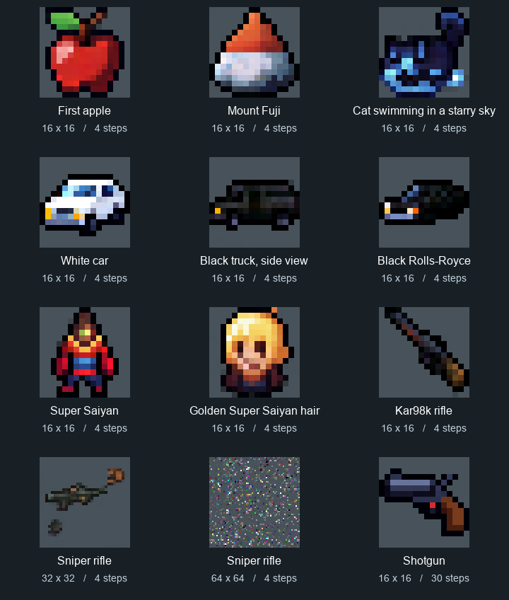

# LiliPixel on Potato Android

A CPU-only pixel art experiment on a Samsung Galaxy A02. A 32-bit Android phone generated the 16 × 16 apple below in **691.6 seconds (11 min 32 s, rounded)** using four sampling steps. This is one end-to-end observation, including model startup and image writing.


The original pixel diffusion model is [LiliPixel V1 190M by Pinkstack](https://huggingface.co/Pinkstack/LiliPixel-V1-190M). It uses the separate [voyage-4-nano text encoder by MongoDB](https://huggingface.co/MongoDB/voyage-4-nano).

## Gallery

These twelve images were generated on the A02. Each caption identifies the requested subject. The contact sheet uses nearest-neighbor enlargement and a gray background for transparency. Follow a subject link for the original PNG at native resolution.



| Requested subject | Native size | Steps | Recorded time (s) |
|---|---:|---:|---:|
| [First apple](examples/first-apple.png) | 16 × 16 | 4 | 691.60 |
| [Mount Fuji](examples/gallery/mount-fuji.png) | 16 × 16 | 4 | 687.13 |
| [Cat swimming in a starry sky](examples/gallery/starry-cat.png) | 16 × 16 | 4 | 649.64 |
| [White car](examples/gallery/white-car.png) | 16 × 16 | 4 | 675.54 |
| [Black truck, side view](examples/gallery/black-truck.png) | 16 × 16 | 4 | 669.59 |
| [Black Rolls-Royce](examples/gallery/black-car.png) | 16 × 16 | 4 | 579.78 |
| [Super Saiyan](examples/gallery/super-saiyan.png) | 16 × 16 | 4 | 621.01 |
| [Golden Super Saiyan hair](examples/gallery/golden-hair.png) | 16 × 16 | 4 | 635.58 |
| [Kar98k rifle](examples/gallery/kar98k.png) | 16 × 16 | 4 | 658.15 |
| [Sniper rifle](examples/gallery/rifle-32.png) | 32 × 32 | 4 | 2,742.58 |
| [Sniper rifle](examples/gallery/rifle-64.png) | 64 × 64 | 4 | 2,747.33 |
| [Shotgun](examples/gallery/shotgun.png) | 16 × 16 | 30 | 4,727.96 |

The [run records](examples/gallery/runs.json) include the prompt as entered, seed, elapsed time and image checksum. English labels translate the original Chinese prompts where applicable. The two larger rifle images share the same prompt and use different random seeds.

## Tested system

| Component | Observed on the test device |
|---|---|
| Phone | Samsung Galaxy A02, SM-A022F |
| OS and ABI | Android 11, armeabi-v7a (32-bit userspace) |
| Processor | MediaTek MT6739 platform, reported as mt6739 |
| Memory | 2,962,148 KiB reported by the kernel (about 2.82 GiB) |
| Termux packages | Python 3.14.10, NumPy 2.5.5, OpenBLAS 0.3.34, zlib 1.3.1 |

## How inference works

The standalone Python runner reads slices of the original SafeTensors files with NumPy memory maps. It tokenizes the prompt with byte-level BPE, computes bidirectional text features with voyage-4-nano, then advances the 24-layer pixel diffusion transformer with Euler sampling and classifier-free guidance (scale 3). Matrix products use the CPU NumPy build linked to OpenBLAS. A live runner on the A02 had libopenblas.so mapped in its process. The program writes RGBA pixels directly to PNG with Python and zlib.

The text encoder expands BF16 weights to float32 as needed. Larger images use attention one head at a time to reduce transient allocations. The bundled split-pattern.txt expands the upstream tokenizer's Unicode character classes for Python's standard regular expression engine.

## Install in Termux

Use an ARM-compatible [Termux installation](https://github.com/termux/termux-app#installation) on Android. Run these commands in Termux. The standalone script requires no root access.

```sh
pkg update
pkg install python python-numpy libopenblas
```

Download the source ZIP from this repository, extract it, and open the directory containing runner.py in Termux. Keep the runner, split pattern and downloaded assets in that same directory. Install the model files with:

```sh
python download_models.py
```

The downloader uses Python 3.11 or later. It fetches pinned releases from the authors' Hugging Face repositories, verifies each SHA-256 and skips files that already match. The three downloads total 1,462,293,445 bytes (about 1.36 GiB). Allow additional space for Termux and its packages. Generation works offline once these files are present.

## Generate the recorded example

```sh
export OPENBLAS_NUM_THREADS=3
python runner.py 'red apple with green leaf, transparent background' 16 4 1466267403 apple.png
```

The arguments are the prompt, square image size, Euler step count, random seed and output filename. Use 16, 32 or 64 for size and a positive step count. The runner prints completed steps. The thread setting matches the original launch environment; the actual number of active compute threads depends on the OpenBLAS build. Open the output at nearest-neighbor zoom to inspect individual pixels.

## First successful run

| Field | Recorded value |
|---|---|
| Prompt | red apple with green leaf, transparent background |
| Seed | 1466267403 |
| Size / steps | 16 × 16 / 4 |
| End-to-end elapsed | 691.6 s |
| Result | Completed, 730-byte RGBA PNG |
| PNG SHA-256 | 9917b164bca2719d81bac8d2184789e626fb818075e7f20f8f4a450e40976bce |
| Process memory observation | VmHWM of 88,844 KiB (86.8 MiB), sampled after step 2 |

The prompt, seed, settings and elapsed time come from the saved on-device job history. The original service launched the same runner as a subprocess. The apple in the gallery was copied directly from the phone. The memory reading was the kernel's peak resident set **up to that sample**. The final lifetime peak was not captured. File cache, other processes and total device memory use are separate measurements. The preview was assembled by reading the installed files and existing result; the original run was not repeated.

## Asset integrity

The following hashes were recomputed on the phone. The weight hashes also match the upstream Git LFS object IDs. The download script contains the immutable upstream URLs.

| Local asset | SHA-256 |
|---|---|
| dit.st | 14c8390efb2fd9309655dc6d49fe2f1dcb3db7ec09360fb41ba0d12719b844f8 |
| enc.st | 3dae0c63c81dcab79ac213af331940a1bf2b8a53ec8646be878552890291ad30 |
| tokenizer.json | c0382117ea329cdf097041132f6d735924b697924d6f6fc3945713e96ce87539 |

## Limits

- The gallery includes one 32 × 32 run and one 64 × 64 run at four steps, and one 16 × 16 run at 30 steps. These are individual elapsed times, without repeated trials or controlled load.
- Four steps are an experimental setting. The upstream model card documents longer schedules. The examples use different prompts and seeds, so they do not isolate the effect of size or step count.
- Text is truncated to 96 tokens. The small BPE implementation targets ordinary prompt text. Special-token handling and numerical parity with the upstream PyTorch pipeline have not been exhaustively tested.
- The seed controls NumPy's random generator. Different library builds, CPU arithmetic or PyTorch's RNG can produce different pixels. Termux package versions available to new installs may differ from the recorded environment.

The [sanitized first-run record](examples/first-run.json) preserves the measured fields and identifies the source of the memory sample.

## Credits and licenses

Credit for LiliPixel V1, its architecture, training and reference pipeline belongs to Pinkstack. This project adapts the published inference algorithm to Android CPU execution. Pinkstack lists OpenMDW-1.1 for the model materials. The proposed release uses the same license for the adaptation. The agreement is included in [LICENSE](LICENSE). See [third-party notices](THIRD_PARTY.md) for encoder and runtime licenses.
